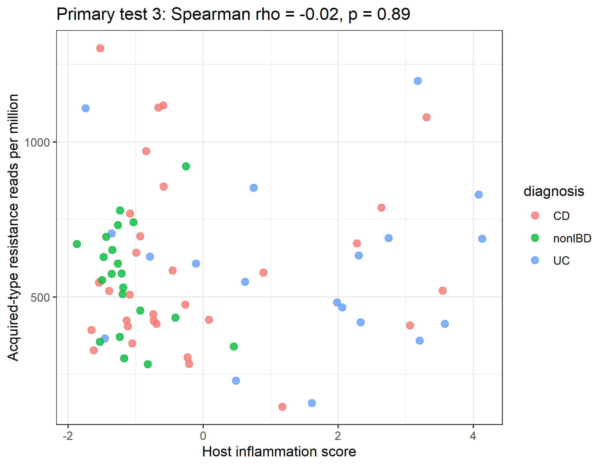
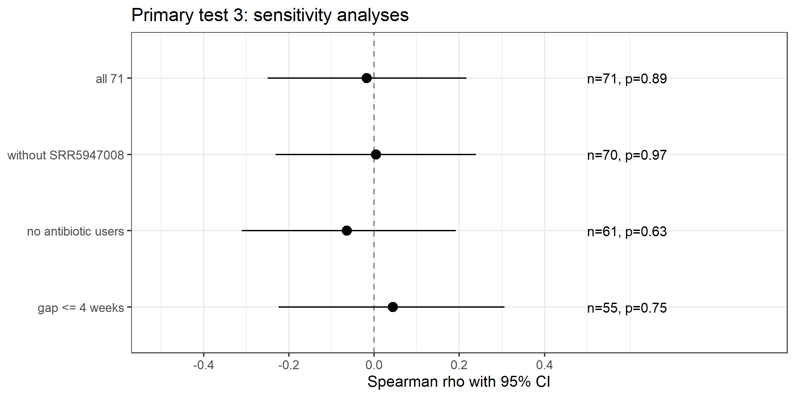
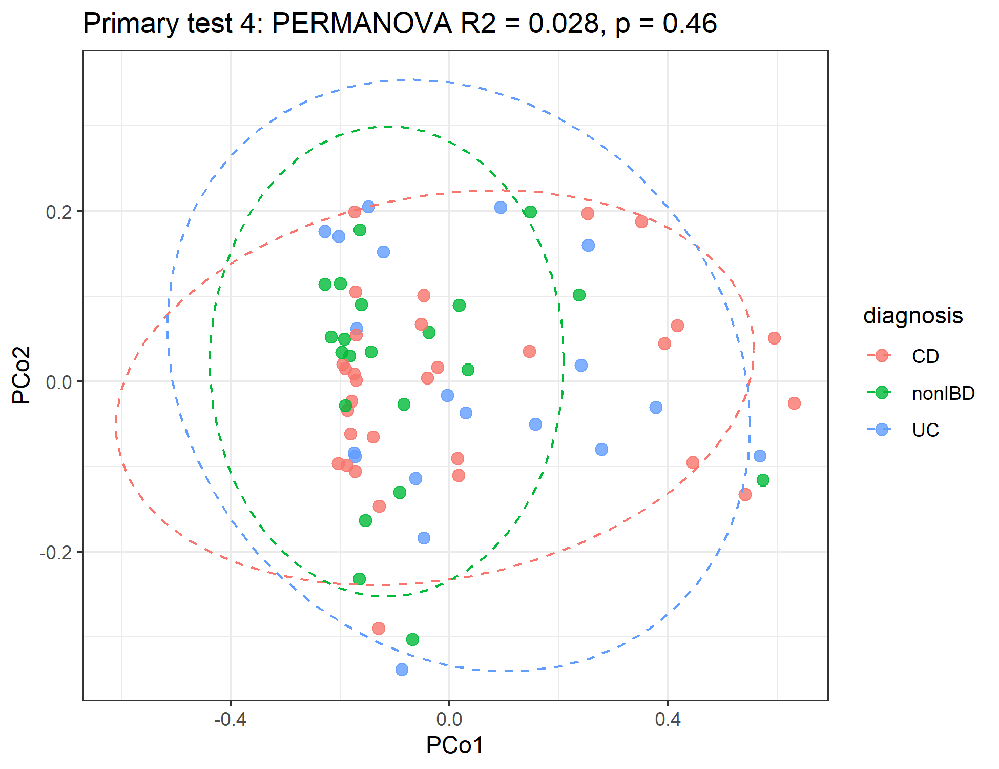
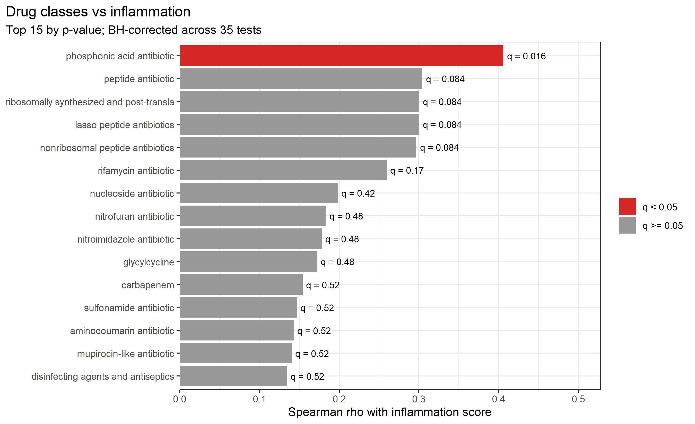
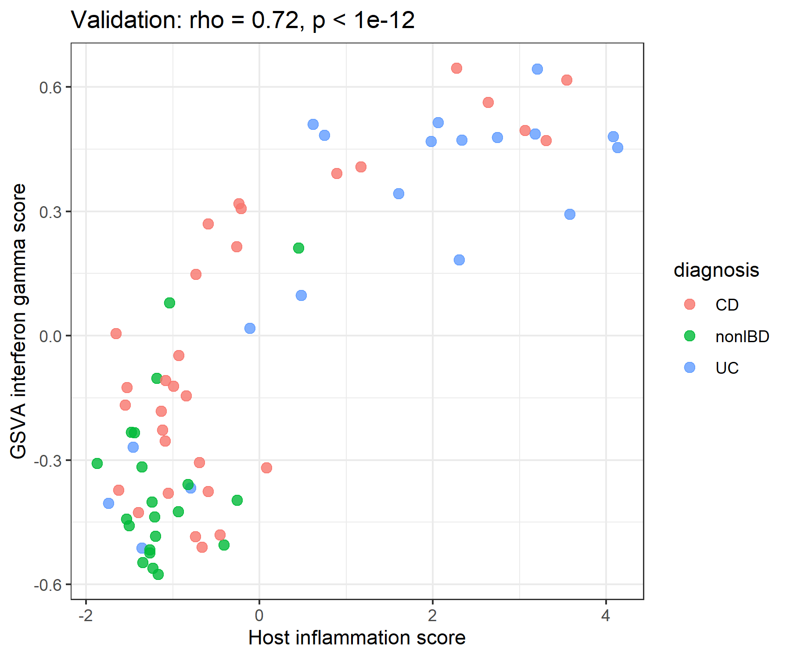
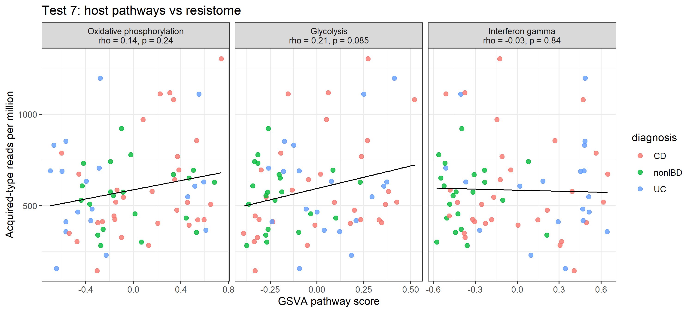
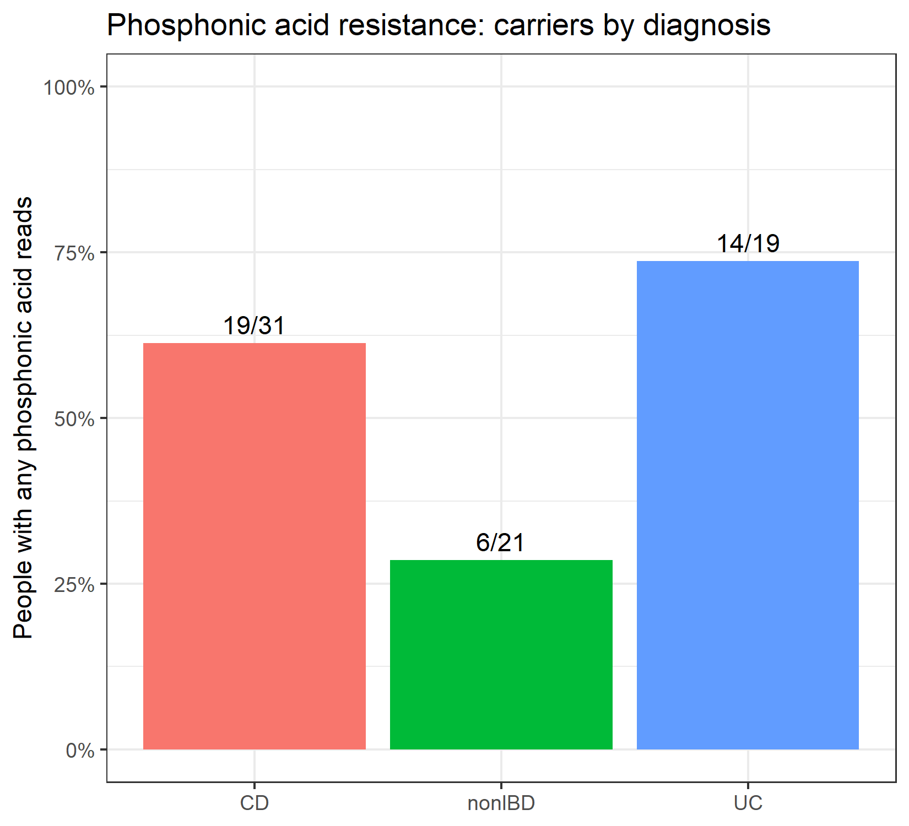
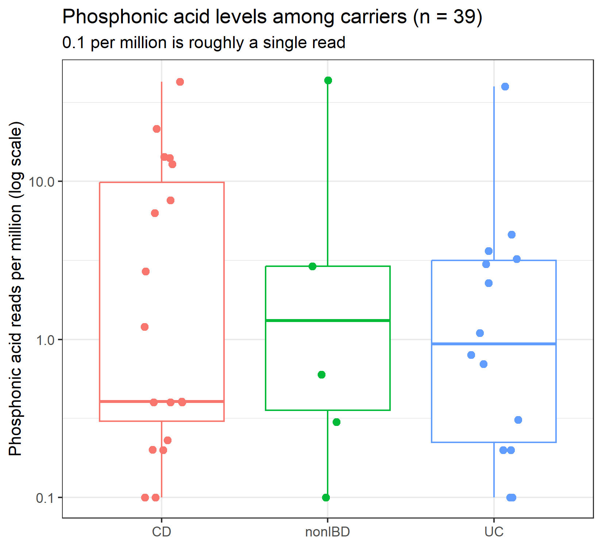
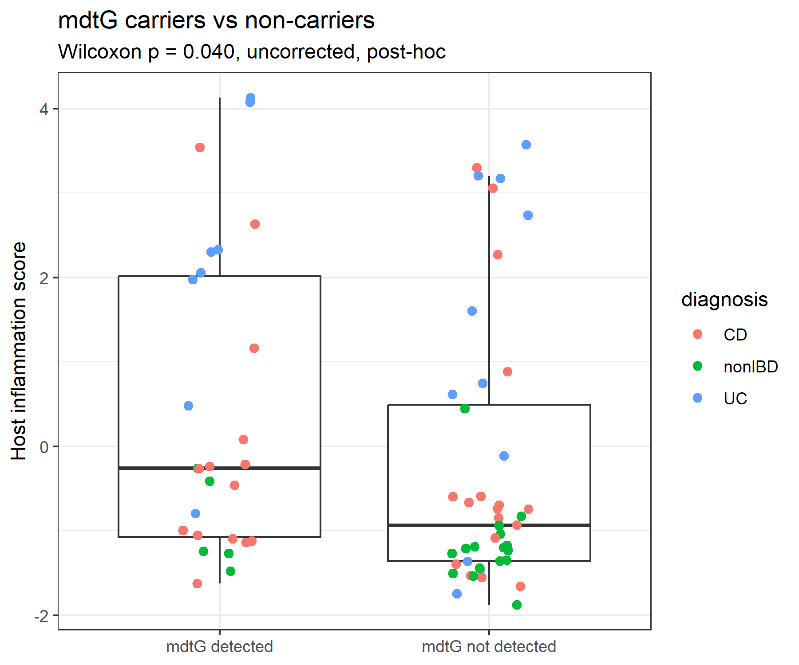
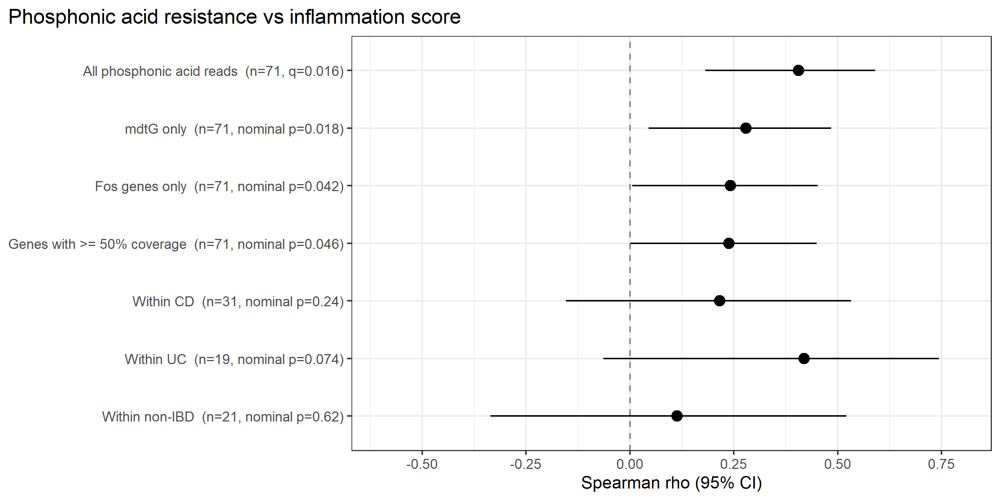

# Inflamed resistome

**Does the gut antibiotic resistome track mucosal inflammation in inflammatory bowel disease?**

A small metagenomics and transcriptomics analysis of 71 people from the HMP2/IBDMDB cohort (Crohn's disease, ulcerative colitis, non-IBD). Stool metagenomes were profiled for antibiotic resistance genes and compared with a gene-expression inflammation score from rectal biopsies of the same people.

**Result in one line:** no evidence that the resistome tracks inflammation (both primary tests are null). One exploratory signal, phosphonic acid resistance (mostly the efflux gene *mdtG*), is reported as a hypothesis for replication, not a finding.

---

## 1. Research question and rationale

**Background.** In IBD, mucosal inflammation changes the gut environment and is accompanied by shifts in the bacterial community, such as expansion of Enterobacteriaceae. Patients can also be exposed to antibiotics. If inflammation favours bacteria that carry antibiotic resistance genes, the stool resistome might rise with the degree of host inflammation.

**Question.** Does the abundance of antibiotic resistance genes in stool correlate with the degree of host mucosal inflammation, measured from biopsy gene expression in the same people?

**Hypothesis.** Genes with mechanisms typically acquired by bacteria (antibiotic inactivation, target protection, target replacement) increase with the host inflammation score. Intrinsic efflux pumps were excluded from this primary measure because they mostly reflect which bacteria are present, not acquired resistance.

**What this analysis can and cannot say.** It is observational and cross-sectional. It can show whether the two measures are associated in this cohort. It cannot show cause or direction.

---

## 2. Data

### 2.1 Source

| | |
|---|---|
| Study | Integrative Human Microbiome Project (HMP2) / IBDMDB. Lloyd-Price et al., *Nature* 2019;569:655-662, doi:10.1038/s41586-019-1237-9 |
| Portal | https://ibdmdb.org |
| ENA project | PRJNA398089 (stool shotgun metagenomes, one run accession per sample) |
| Sample metadata | `hmp2_metadata_2018-08-20.csv` from the portal |

### 2.2 What comes from the original study and what was done here

| From the original study (not generated by me) | Generated in this project |
|---|---|
| Stool shotgun metagenome reads (ENA) | Read trimming, resistance gene mapping, per-sample resistome tables |
| Host rectal-biopsy RNA-seq, the authors' processed counts (raw reads are controlled access) | Normalisation, the inflammation score, pathway scores |
| Sample metadata (diagnosis, sex, antibiotic use, collection weeks) | Cohort assembly, all statistics, all figures |

### 2.3 Cohort (n = 71)

- **Groups:** Crohn's disease (CD) n = 31, ulcerative colitis (UC) n = 19, non-IBD n = 21. 71 unique participants, one sample each, so no repeated measures.
- **Selection.** Participants were drawn from HMP2 (PRJNA398089). We included people with (i) a rectal biopsy in the authors' processed host RNA-seq count table (earliest biopsy used if several), and (ii) a stool shotgun metagenome in ENA that matched the 2018 metadata file, taken within 12 weeks of the biopsy (nearest sample used), with at least 1 million reads. The 12-week window was chosen from group sizes before any metagenomic data were analysed. Of 89 people with a rectal biopsy, 86 had a matched metagenome, 84 had a recorded gap, 74 fell within 12 weeks, and 73 met the read threshold. Two further people were excluded for near-empty host libraries (total counts 0 and 150,338; biopsies HSM5FZAZ and MSM719ME), leaving 71 (31 CD, 21 non-IBD, 19 UC). The median gap is 2 weeks (maximum 12). Antibiotic users were kept and used as a covariate (61 non-users, 10 users).
- **Linking IDs:** each person has a host sample ID (`CSM...`) and a metagenome run accession (`SRR...`); the manifest in `data/` links them to their download URLs and MD5 checksums.
- **Depth:** most samples have about 10 million reads (median 9,999,778; minimum 3,050,552) because processing was capped at the first 5 million read pairs.

### 2.4 Pilot and when the tests were fixed

A 15-sample pilot (five per diagnosis group, chosen from antibiotic-free samples with the smallest biopsy-to-stool gap, including SRR5947008, which was run by hand) was processed first and is part of the 71. The pilot results, including the split between efflux and other mechanisms, were seen before the acquired-type definition and the primary tests were fixed. The tests were therefore specified after a 15-person pilot look and before the 71-person analysis. They are **not pre-registered**.

### 2.5 Host inflammation score

`infl_score` is the mean z-score of 8 inflammatory genes (S100A8, S100A9, LCN2, DUOX2, CXCL8, IL1B, MMP3, REG1A) minus the mean z-score of 5 epithelial genes (GUCA2A, GUCA2B, AQP8, CA1, SLC26A3), computed on variance-stabilised expression with each gene z-scored across samples. CLCA4 was excluded. It is a marker-gene score from bulk tissue, not a histology grade.

---

## 3. Pipeline

Steps are listed in the order they ran. Only steps that were actually performed are listed; skipped steps are stated after the table.

| # | Step | Tool and settings | Script |
|---|---|---|---|
| 1 | Download and verify stool reads | ENA download, MD5 check | `scripts/pipeline.sh`, `data/cohort_manifest_v2.tsv` |
| 2 | Trimming and quality filtering | fastp 1.3.7: `--detect_adapter_for_pe --cut_tail --cut_mean_quality 20 --length_required 50 --reads_to_process 5000000` (first 5 million read pairs per sample); fastp HTML/JSON reports kept as QC | `scripts/pipeline.sh` |
| 3 | Human read removal (2 samples only) | bowtie2 `--sensitive` against GRCh38 | `scripts/pipeline.sh` |
| 4 | Resistance gene mapping | RGI 6.0.8, `rgi bwt -a kma --local --clean`, CARD 4.0.2 | `scripts/pipeline.sh` |
| 5 | Per-sample resistome tables | Reads per million = mapped reads / total reads x 1e6; "acquired-type" classification (below) | R (interactive session) |
| 6 | Host inflammation score | DESeq2 1.52.0, variance-stabilising transformation of the authors' counts, marker-gene score (section 2.5) | R (interactive session) |
| 7 | Host pathway scores | GSVA 2.6.10 (Gaussian kernel) on log2 normalised counts; MSigDB Hallmark oxidative phosphorylation, glycolysis, interferon gamma response (msigdbr 26.1.1) | R (interactive session) |
| 8 | Statistics | R 4.6.1, Bioconductor 3.23; vegan 2.7.6, dplyr 1.2.1, tidyr 1.3.2, readr 2.2.0, ggplot2 4.0.3; `set.seed(1)`, 9,999 permutations | R (interactive session) |
| 9 | Figures | ggplot2 | R (interactive session) |

**Steps not performed**
- **Taxonomic profiling.** Not run (3.9 GB RAM and limited disk space). Test 2 depended on it and was never run.
- **Human read removal for 69 of 71 samples.** Reads per million are relative to total reads including any host reads. The two samples that went through removal were SRR5947008 (also uncapped, with only 3.8 million reads) and the pilot sample SRR5935961.
- **Host RNA-seq alignment and counting.** Not performed; the authors' processed counts were used.
- **Assembly, binning, or mobile-element analysis.** Not performed.

**Environments.** Two conda environments were used: `ibd` (fastp and utilities) and `rgi` (RGI and CARD).

### Definitions

- **Acquired-type resistance** (fixed in advance): genes whose RGI mechanism contains *antibiotic inactivation*, *target protection* or *target replacement*, excluding any entry that also contains *efflux* or *target alteration*. Entries with both an acquired and an excluded mechanism (for example "target alteration; target replacement") are excluded, which is conservative.
- **Tests**
  - **Primary** (Holm correction across two tests, threshold 0.025): **Test 3**, Spearman correlation of acquired-type reads per million with `infl_score`, plus a depth-adjusted, log-transformed model `log10(rpm_acq + 1) ~ infl_score + sex + antibiotics + week_gap + log10(total_reads)`. **Test 4**, PERMANOVA of resistome composition (Bray-Curtis on log1p reads per million per gene) by diagnosis, with a dispersion check.
  - **Test 2** (E. coli / Enterobacteriaceae abundance from taxonomy vs `infl_score`) was a primary test moved to secondary under a rule written in advance: if no taxonomy exists when the analysis starts, it leaves the primary set.
  - **Secondary** (one Benjamini-Hochberg correction across 35 tests): total resistance reads (test 1), 30 drug classes each detected in at least 10 people (test 5), gene richness (test 6), three host pathway scores (test 7).
  - **Post hoc** (hypothesis-generating): diagnosis contrasts and all follow-up of the phosphonic acid result.

---

## 4. Results

### 4.1 Primary test 3: acquired-type resistance vs inflammation



- **Observed.** No association: Spearman rho = -0.017, p = 0.886 (Holm-adjusted 0.915). In the adjusted model the inflammation estimate is 0.0015 (95% CI -0.025 to 0.028) on the log10 scale, roughly -6% to +7% per score unit. Five sensitivity runs agree (below).
- **What it might mean.** Acquired-type reads are dominated by tet(Q), CfxA2, CfxA6, tet(O), mel and tet(W), which are common gut genes found in most people (tet(O) in all 71, tet(Q) in 70, tet(W) in 67). A stable core of widespread genes may mask changes in rarer genes. This is an interpretation, not a tested result.
- **What it cannot establish.** It cannot rule out a small effect. With 71 people a correlation of about 0.26 is the smallest that would reach p < 0.025, and about 0.35 is needed for 80% power (approximate). It says nothing about cause or about which organisms carry the genes.



| Analysis | n | rho | p |
|---|---|---|---|
| All samples | 71 | -0.017 | 0.886 |
| Without SRR5947008 (run by hand) | 70 | 0.005 | 0.971 |
| No antibiotic users | 61 | -0.064 | 0.627 |
| Biopsy-to-stool gap <= 4 weeks | 55 | 0.044 | 0.749 |
| Genes with >= 50% coverage only | 71 | -0.026 | 0.833 |

### 4.2 Primary test 4: resistome composition vs diagnosis



- **Observed.** Diagnosis explains 2.8% of the variation between resistomes (PERMANOVA R2 = 0.028, F = 0.96, p = 0.457; Holm-adjusted 0.915). The dispersion check is not significant (p = 0.20), so the result is unlikely to be an artefact of unequal spread. The three groups overlap almost completely in the PCoA.
- **What it might mean.** Overall resistance gene profiles look similar in CD, UC and non-IBD at this sample size.
- **What it cannot establish.** Small differences, or differences in specific genes or taxa, may exist below what 71 people can detect.

### 4.3 Secondary tests (35, Benjamini-Hochberg)



- **Observed.** Total resistance reads vs score: rho = 0.10, p = 0.40. Gene richness: +1.4 genes per score unit, p = 0.49. Host pathways vs acquired-type reads: oxidative phosphorylation rho = 0.14 (p = 0.24), glycolysis rho = 0.21 (p = 0.085), interferon gamma rho = -0.03 (p = 0.84). Of 30 drug classes, only phosphonic acid antibiotic passes correction (rho = 0.406, p = 0.00045, q = 0.016); the next classes have q >= 0.084. The peptide-type classes have near-identical statistics and appear to be the same genes counted under different labels, so they are one signal, not four.
- **What it might mean.** Neither total resistome load nor the host metabolic and interferon programmes tracked acquired-type resistance.
- **What it cannot establish.** These are exploratory tests; apart from the phosphonic acid class, nothing here is distinguishable from chance.



The interferon gamma pathway score tracks the inflammation score strongly (rho = 0.72, p < 1e-12), which supports that the host scores are attached to the right people.



### 4.4 The phosphonic acid lead (exploratory)




- **Observed.**
  - About 90% of reads in this class come from **mdtG**, an efflux gene, not from the fosfomycin-inactivating *Fos* genes.
  - Carriers (any phosphonic acid reads): non-IBD 6/21, CD 19/31, UC 14/19.
  - With diagnosis, sex, antibiotics, gap and depth in the model, the rank model gives p = 0.070 and the carrier-status logistic model gives OR 1.50 (95% CI 0.95 to 2.37).
  - With only genes at >= 50% coverage, 16 carriers remain and rho = 0.24 (nominal p = 0.046).
  - Within each diagnosis the direction is positive (CD 0.22, UC 0.42, non-IBD 0.11); no subgroup is significant alone.
  - A crude E. coli proxy (reads on E. coli-referenced genes, excluding mdtG) tracks mdtG strongly (rho = 0.73) and reduced the inflammation estimate by about 25%, short of the pre-set threshold of half.
  - The six post-hoc diagnosis contrasts: none passes correction; the closest is phosphonic acid in UC vs non-IBD (q = 0.057).




*Figure 9 legend:* Spearman correlation between phosphonic acid resistance reads and the host inflammation score. The top row is the secondary test in the BH-corrected family (q = 0.016, 35 tests). The other rows are post-hoc robustness analyses with nominal (uncorrected) p-values: gene groups, a >= 50% coverage filter and within-diagnosis subsets. These rows overlap heavily and are not independent confirmations. Bars show 95% confidence intervals.

- **What it might mean.** A weak association, with carriers more common in IBD, consistent with the idea that Enterobacteriaceae-type bacteria expand in inflamed guts. That is a hypothesis; the data do not test it.
- **What it cannot establish.** It rests on one drug class chosen from 30, it is no longer significant after adjustment, and a read-based mdtG signal does not show which organism carries the gene, nor that anyone's bacteria are clinically fosfomycin-resistant (mdtG is a chromosomal efflux gene that CARD lists under this class). It needs replication, ideally with taxonomic profiling.

---

## 5. Limitations

- **Sample size.** 71 people limits power; modest true effects could be missed.
- **Taxonomy was not run.** We cannot say whether the phosphonic acid / mdtG signal reflects E. coli abundance.
- **Read-based CARD mapping** shows gene presence and relative abundance, not which organism carries a gene, nor expression or mobility.
- **"Acquired-type" is a mechanism-based proxy**, not proof of horizontal transfer.
- **Cross-sectional design.** Biopsy and stool were collected up to 12 weeks apart; no causal direction can be inferred.
- **Few antibiotic users** (10 of 71); antibiotic effects are poorly estimated.
- **Limited depth** (about 10 million reads per sample) reduces detection of rare genes; 11 of the 39 phosphonic acid carriers rest on only 1 to 2 reads.
- **Human reads kept for 69 of 71 samples.** The share of host DNA in stool can rise with active inflammation, which could shift reads per million downward in more inflamed people. The host-read fraction was not measured, so this could not be adjusted for.
- **The inflammation score** comes from 13 marker genes in bulk rectal-biopsy RNA-seq, not from histology.
- **Multiple testing.** 2 primary tests, 35 secondary tests, 6 post-hoc contrasts and several robustness checks on one lead. Post-hoc analyses overlap heavily and are not independent confirmations.
- **Single cohort,** no replication set; the tests were specified after a 15-person pilot look.

---

## 6. Conclusion and next steps

**Conclusion.** In 71 people there was no evidence that the stool resistome tracks host mucosal inflammation, either as acquired-type resistance reads or as overall composition. One exploratory signal (phosphonic acid resistance, mostly mdtG) is worth testing in a larger dataset.

**Next steps**
1. Run taxonomic profiling (for example Kraken2 or MetaPhlAn on a machine with more memory) to test whether the mdtG signal tracks *E. coli* / Enterobacteriaceae abundance (the original test 2).
2. Remove human reads from all samples and quantify host DNA fraction, then re-check the inflammation association.
3. Use the longitudinal HMP2 samples to ask whether resistome changes follow inflammation flares within people.
4. Replicate in an independent IBD metagenome cohort.
5. Add a consolidated, tested analysis script and conda environment files so the statistics can be re-run end to end.

---

## 7. Repository structure

```
inflamed-resistome/
  README.md
  LICENSE
  data/       cohort_manifest_v2.tsv (accessions, URLs, MD5), cohort2_with_score.csv (metadata and inflammation score)
  scripts/    pipeline.sh (metagenome processing)
  results/    result tables (CSV) and analysis_log.txt
  figures/    fig1 to fig9 (PNG)
```

Raw reads are not stored here. Download them with the accessions and URLs in `data/cohort_manifest_v2.tsv`.

**Result tables:** `primary_tests_results.csv`, `secondary_drug_classes.csv`, `secondary_family_BH_final.csv`, `secondary_test7_pathways.csv`, `posthoc_contrasts.csv`, `posthoc_contrasts_BH.csv`, `phosphonic_acid_robustness.csv`, `resistome_per_sample_v5.csv`, `analysis_log.txt` (a dated log of the analysis decisions).

| Figure | Shows |
|---|---|
| `fig1_test3.png` | Inflammation score vs acquired-type reads (primary test 3) |
| `fig2_pcoa.png` | PCoA of resistome composition by diagnosis (primary test 4) |
| `fig3_drug_classes.png` | Top 15 drug classes with BH q-values |
| `fig4a_pa_carriers.png` | Phosphonic acid carriers by diagnosis |
| `fig4b_pa_levels.png` | Phosphonic acid levels among carriers |
| `fig5_sensitivity.png` | Sensitivity runs for test 3 |
| `fig6_pathways.png` | Host pathway scores vs acquired-type reads |
| `fig7_mdtg.png` | mdtG carriers vs non-carriers by inflammation score |
| `fig8_validation.png` | Interferon gamma score vs inflammation score |
| `fig9_pa_robustness.png` | Phosphonic acid signal across robustness analyses |

---

## 8. How to reproduce

**A. Process the metagenomes (Linux or WSL, conda, several GB of disk).**
1. Install fastp 1.3.7 (conda environment `ibd`) and RGI 6.0.8 with CARD 4.0.2 (conda environment `rgi`); optionally build a GRCh38 bowtie2 index for human-read removal.
2. Edit the paths at the top of `scripts/pipeline.sh` (`BASE`, `REF`, `CARD`).
3. Run `bash scripts/pipeline.sh data/cohort_manifest_v2.tsv`. Each sample writes a `*.gene_mapping_data.txt` and `*.overall_mapping_stats.txt`; finished samples are skipped on a restart.

**B. Statistics and figures.** These were run interactively in R 4.6.1 and are specified in sections 3 and 4 (definitions, models, correction methods, seed and package versions). A consolidated analysis script is listed under next steps and is not yet included, so the statistics cannot yet be re-run with one command. The result tables in `results/` hold the numbers reported here, per sample and per test.

**Outputs:** the result tables and figures listed in section 7.

---

## 9. Licence, citation and author

- Code: MIT licence (see `LICENSE`). Figures and tables: CC BY 4.0.
- If you use this work, please also cite the original study: Lloyd-Price et al., *Nature* 2019, doi:10.1038/s41586-019-1237-9.
- Tools: fastp, bowtie2, RGI/KMA with CARD, DESeq2, GSVA, MSigDB Hallmark (via msigdbr), vegan.
- Author: [khyati-ch](https://github.com/khyati-ch) on GitHub.
