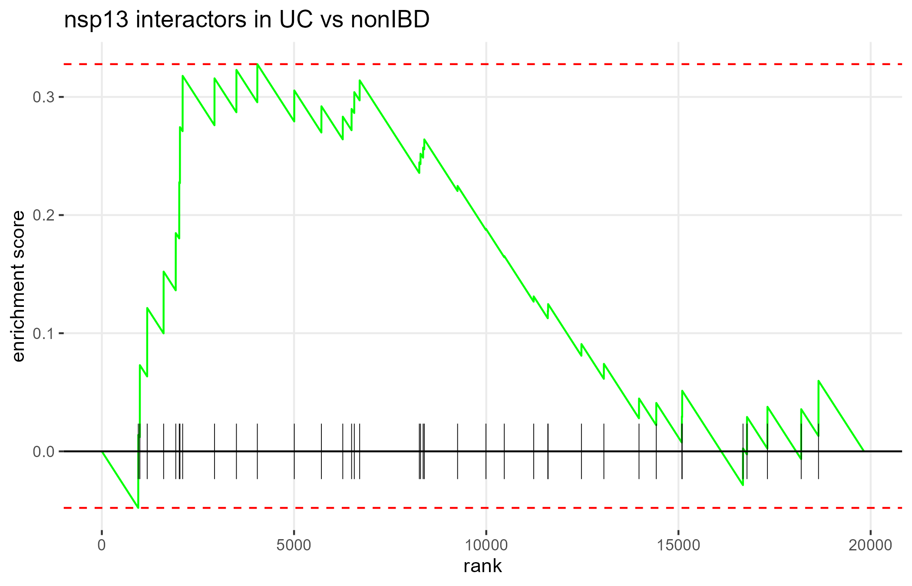
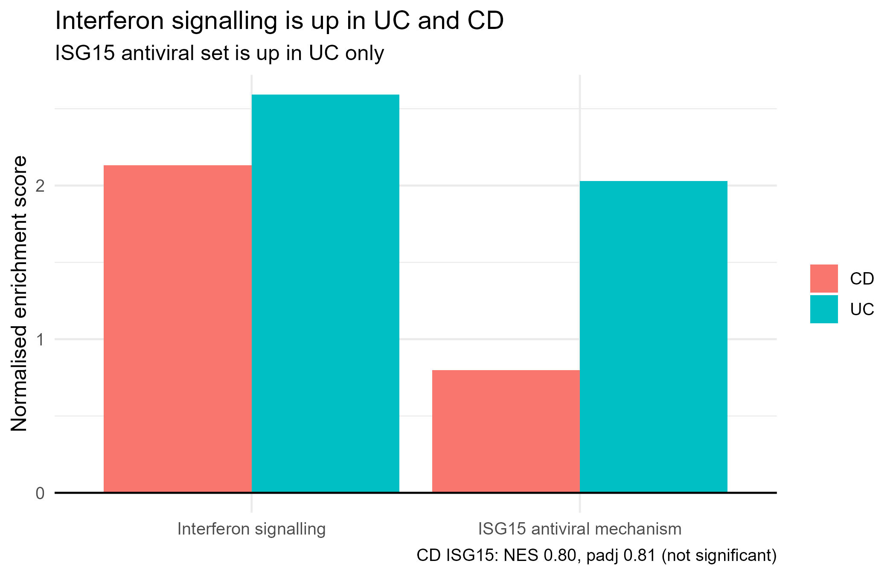
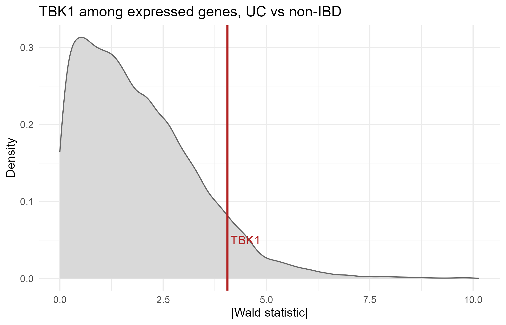

# Viral protein interactions and host gene expression in inflammatory bowel disease

## 1. Overview and research question

This side project tests whether the human proteins bound by SARS-CoV-2 nsp13 are altered in inflamed colonic mucosa from people with ulcerative colitis (UC). It uses the same host expression results as the main resistome analysis in the parent folder.

**Primary question:** Are the human interactors of nsp13 shifted in UC or Crohn's disease (CD) biopsies, compared with non-IBD controls?

**Secondary question:** Is TBK1, a reported nsp13 partner and central innate immune kinase, altered in UC tissue, and does that change hold in an independent cohort?

**Summary of findings:** The pre-specified test found no detectable shift in nsp13's interactors as a group. The positive control (interferon signalling) worked. TBK1 emerged as a specific exploratory lead: it is up in UC, not in CD, it remains highly ranked after correcting for expression level and after removing interferon-signalling genes, and it rises in the same direction in an independent microarray cohort, though not significantly.

## 2. Biological background and rationale

SARS-CoV-2 encodes accessory and non-structural proteins that bind host proteins. Nsp13 is a helicase that interacts with several host proteins, including TBK1, a kinase that activates interferon regulatory factor 3 (IRF3) and drives type I interferon production. Published work reports that nsp13 binds TBK1 and reduces its activation, which would blunt the antiviral response.

Inflammatory bowel disease involves dysregulated mucosal immune signalling, including interferon-related pathways. This project asks whether the host targets of a viral protein are part of the disease-associated expression programme in the gut. Because the proteins were identified in overexpression experiments, a link in tissue would be supportive but not proof of an interaction during infection.

## 3. Data sources and cohort

| Source | Description | Role |
|---|---|---|
| Gordon et al. (2020), Supplementary Table 2 | 332 high-confidence SARS-CoV-2–human interactions across 27 viral baits, from affinity-purification mass spectrometry in HEK293T cells. Zenodo record 3779045; included as `data/zenodo/Table2.xlsx`. | Interactor sets |
| HMP2/IBDMDB rectal biopsy RNA-seq | 71 participants after exclusions: 31 Crohn's disease, 19 ulcerative colitis, 21 non-IBD. Patient-level data are not included in this repository. | Discovery expression |
| GEO GSE75214 (GPL6244, Affymetrix Human Gene 1.0 ST) | Mucosal biopsies, restricted to colon: 74 active UC, 11 normal controls (97 colonic UC samples in total, of which 23 inactive UC were excluded). Ileal samples excluded. | TBK1 replication |
| Taman et al. (2017), PMID 29040430 | RNA-seq, 14 treatment-naïve UC and 16 controls. | Considered for second replication; excluded because no public count data were identified |

Discovery cohort: count filtering retained genes with at least 10 counts in at least 19 of 71 samples, giving a background of 19,825 genes.

## 4. Pre-specified statistical analysis

The design was written and dated before the nsp13 overlap was examined (`prespecification_note.txt`).

- **Bait:** nsp13 only, with no backup bait.
- **Background:** the 19,825 genes in the DESeq2 object.
- **Ranking statistic:** DESeq2 Wald statistic for each gene.
- **Primary contrast:** UC vs non-IBD. **Secondary:** CD vs non-IBD.
- **Primary test:** fgsea on the full ranked gene list, with each bait's expressed interactors as a gene set (size 5 to 500, 10,000 permutations). Baits are ranked by absolute normalised enrichment score (NES), two-sided, with direction reported separately.
- **Expression-matched control:** 1,000 random gene sets with the same expression-bin composition as nsp13's interactors (10 bins of mean expression).
- **Positive control:** two Reactome gene sets, Interferon Signaling and ISG15 Antiviral Mechanism, tested with Holm correction across the two.
- **Minimum size:** fewer than 5 expressed interactors would be reported as underpowered.
- **Replication rules:** written before the replication was run. Replicates means same direction and p < 0.05. Fails means opposite direction, or p at or above 0.05 with a fold change near zero. Inconclusive means same direction with p at or above 0.05.

## 5. Results: enrichment tests and positive controls

Of nsp13's 40 high-confidence interactors, 38 were present in the expressed gene set. CEP43 and TLE5 did not match, probably because of gene-name differences. Seventeen of 27 baits had at least five expressed interactors and were tested.

### Enrichment of nsp13 interactors

| Contrast | nsp13 NES | p | padj | Rank by absolute NES | Expression-matched random p |
|---|---|---|---|---|---|
| UC vs non-IBD (primary) | 1.15 | 0.26 | 0.87 | 5 of 17 | 0.30 |
| CD vs non-IBD (secondary) | −1.11 | 0.27 | 0.45 | 11 of 17 | 0.26 |

The pre-specified test gives no detectable enrichment of nsp13's interactors in either disease. Its power is limited by the 38-gene set size, so this result supports "no detectable shift" rather than "no effect".

### Positive control: interferon signalling

| Gene set | UC NES | UC padj | CD NES | CD padj |
|---|---|---|---|---|
| Interferon Signaling | 2.59 | 6.3 × 10⁻²⁴ | 2.13 | 5.9 × 10⁻¹² |
| ISG15 Antiviral Mechanism | 2.03 | 1.9 × 10⁻⁵ | 0.80 | 0.81 |

Interferon signalling is strongly up in both diseases. This confirms that the pipeline detects the biology it is meant to detect, which makes the null result for nsp13 a valid measurement rather than a technical failure. No nsp13 interactor lies within either interferon set.

## 6. Exploratory analysis: TBK1

TBK1 was identified after the main analysis, from nsp13's 38 testable interactors, on prior biology. It is therefore an exploratory finding. The steps below test it against different kinds of evidence.

### Evidence chain

**6.1 Biological rationale.** TBK1 phosphorylates IRF3 to switch on type I interferon genes. Published work reports that nsp13 binds TBK1 and reduces its activation.

**6.2 Interaction evidence.** TBK1 is a high-confidence nsp13 interactor (SAINT Bayesian FDR 0.0, MIST score 0.99). Across the 27 baits in the dataset, nsp13 is the only bait that binds TBK1.

**6.3 Discovery expression, UC.** TBK1 is up in UC: log₂ fold change +0.34, p = 5 × 10⁻⁵, genome-wide adjusted p = 0.0006. It ranks at the 92nd percentile of |stat| among expressed genes.

**6.4 Not explained by expression level.** Highly expressed genes tend to give larger statistics for the same fold change. Compared with genes of similar expression, TBK1 ranks at the 93rd percentile (0.926), almost identical to its rank across all genes (0.920).

**6.5 Specific to UC.** In CD, using the same cohort and method, TBK1 is not significant (log₂FC +0.12, p = 0.12). The signal is therefore not a generic IBD effect.

**6.6 Not explained by the interferon response.** Removing the 251 Reactome Interferon Signaling genes from the background leaves 19,574 genes. TBK1 remains at the 92nd percentile (0.921). TBK1 stands out beyond the interferon signal.

**6.7 Independent replication, same direction.** In GSE75214 (74 active UC, 11 normal colonic controls, microarray), TBK1 rises in the same direction: log₂FC +0.13, limma t = 1.95, p = 0.054, adjusted p = 0.11. It ranks at the 48th percentile of |t|, and after removing interferon-signalling genes its rank is unchanged. Under the pre-specified rules this is an inconclusive replication. It confirms direction in a second cohort, but the effect is smaller and the control group is small.

### Summary table

| Analysis | Result |
|---|---|
| Interaction (Gordon et al.) | SAINT BFDR 0.0, MIST 0.99; nsp13 is the only bait binding TBK1 |
| Discovery, UC | log₂FC +0.34, p = 5 × 10⁻⁵, padj 0.0006; 92nd percentile of \|stat\| |
| Discovery, UC, expression-matched | 93rd percentile |
| Discovery, UC, interferon genes removed | 92nd percentile (19,574 genes remaining) |
| Discovery, CD | log₂FC +0.12, p = 0.12, not significant |
| Replication, UC (GSE75214) | log₂FC +0.13, p = 0.054; 48th percentile of \|t\| |
| Structure (nsp13–TBK1) | Not resolved; the positive control also scored below the confident range |

### Interpretation

The most supported reading is that TBK1 is a UC-specific, innate immune gene that rises in inflamed colon tissue. Its rise is not explained by expression level or by the interferon signature, and it points in the same direction in an independent cohort. Because it is a single gene selected after the analysis began, it should be treated as a strong hypothesis rather than a confirmed association.

## 7. Structural modelling: AlphaFold-Multimer

**Method.** ColabFold v1.6.3 with AlphaFold2-multimer v3, five models per pair and three recycles. Each pair was modelled as a single run with the two sequences joined by a colon. nsp13 sequence: PDB 6ZSL (residues 3 to 603 of the chain; the first two residues are an expression leftover). TBK1 (UniProt Q9UHD2), TBKBP1 (A7MCY6), GAPDH (P04406), ORF9b (P0DTD2), and TOM70 (O94826) sequences from UniProt.

**Results.**

| Pair | Role | Best-model ipTM | Other models | ipSAE (best) |
|---|---|---|---|---|
| ORF9b + TOM70 | Positive control (known complex) | 0.40 | 0.37–0.39 | 0.05 |
| nsp13 + TBK1 | Test | 0.30 | 0.17–0.18 | 0.005 |
| nsp13 + GAPDH | Negative control | 0.14 | 0.13–0.14 | 0 |

**Interpretation.** The positive control reached an ipTM of 0.40, which is below the usual confident threshold (about 0.6). The ORF9b–TOM70 model does place ORF9b's central region against TOM70, as the crystal structure shows (PDB 7DHG), so the method captured part of the known interface. Overall confidence in ORF9b was low (mean pLDDT about 25 in this model). The nsp13–TBK1 score was higher than the negative control in its best model, but the difference is small and does not support a confident interface. The structure check therefore neither confirms nor excludes direct binding.

**PAE plots** from the five-model runs are held with the ColabFold result files and will be added to `alphafold/figures/`.

## 8. Limitations and interpretation

- **Source of interactions.** The Gordon et al. data come from tagged overexpression in HEK293T cells. They reflect neither viral infection nor gut tissue.
- **Affinity purification.** Detected partners may be bound indirectly within larger complexes, so a shared interaction does not guarantee direct contact.
- **Power.** Only 38 nsp13 interactors were testable, so the pre-specified test detects large shifts only. Ten of 27 baits were too small to test.
- **Post-hoc selection.** TBK1 was chosen after the analysis began. The expression-matched and interferon-removed checks reduce, but do not remove, the risk that the signal reflects the choice.
- **Interferon check.** Removing 251 interferon genes from about 19,800 changes the background only modestly. A stronger test would compare TBK1 with other innate immune gene sets outside the interferon pathway.
- **Replication.** The replication is one microarray cohort with 11 controls, different tissue location from the discovery RNA-seq, and a different platform. A second RNA-seq replication was not possible with public data in the search carried out. The replication result is inconclusive under the pre-specified rules.
- **Transcript-level data.** mRNA changes are a proxy for protein changes. nsp13 acts by reducing TBK1 phosphorylation, which is a protein-level event that these data cannot measure.
- **Structural prediction.** The AlphaFold positive control did not reach the confident range, so the nsp13–TBK1 model cannot be used as evidence either way. Single seeds were used.
- **Input checks.** Two gene names (CEP43, TLE5) could not be matched across datasets. The ORF9b input length should be verified against UniProt P0DTD2 before the structural results are published.

## 9. Reproducibility and repository contents

**Software:** R 4.6.1, Bioconductor 3.23, DESeq2 1.52.0, fgsea 1.38.0, msigdbr 26.1.1, limma, GEOquery, tidyverse, readxl. ColabFold v1.6.3 for structure prediction, UCSF ChimeraX for inspection.

**Reproducing the analysis:**

1. `analysis_script.R`: the discovery analysis, including the enrichment tests, expression-matched control, and interferon sets.
2. `exploratory_checks.R`: the TBK1 expression-matched, per-interactor, and interferon-removed checks.
3. `replication_prespecification.txt`: the GSE75214 replication steps, the replication rules, and the excluded candidates.
4. `results_summary.txt`: the numerical results used in this README.

**Repository contents:**

- `analysis_script.R`, `exploratory_checks.R`: analysis code
- `prespecification_note.txt`, `replication_prespecification.txt`: dated design and replication rules
- `results_summary.txt`: results used in this README
- `results/proteomics/`: enrichment CSVs, interferon CSVs, the interferon-removed TBK1 result (`tbk1_interferon_removed.csv`), and the figures
- `replication/GSE75214_UC_vs_CTRL_limma.csv`: replication gene-level results
- `alphafold/alphafold_summary.csv`: structure scores (PAE figures to be added to `alphafold/figures/`)
- `data/zenodo/Table2.xlsx`: Gordon et al. interaction table

Patient-level HMP2 data are not included. The discovery analysis begins from the DESeq2 result tables.

## 10. Future scope

1. **Co-immunoprecipitation.** Express tagged nsp13 in HEK293T cells, immunoprecipitate it, and blot for TBK1. This tests direct binding, which the interaction table and structural models cannot settle.
2. **Protein-level measurement.** Measure total TBK1 and phospho-TBK1 in inflamed and non-inflamed UC tissue, by western blot or immunohistochemistry.
3. **Targeted structural modelling.** Model nsp13 against TBK1's scaffold dimerisation domain, the region the published mechanism implicates. Confirm domain boundaries in UniProt first.
4. **RNA-seq replication.** Repeat the TBK1 test in an RNA-seq UC cohort with public counts, under a new pre-registration.
5. **Stronger specificity test.** Compare TBK1 with innate immune gene sets outside the interferon pathway, to see whether it stands out from the wider innate response.
6. **Shared-partner analysis.** Use the full Gordon et al. dataset or BioGRID to find host proteins shared by nsp13 and TBK1 interactors.

## References

- Gordon, D. E., et al. (2020). A SARS-CoV-2–human protein–protein interaction map reveals drug targets and potential drug-repurposing. *Nature*, 583, 459–468. PMID 32353859.
- Taman, H., et al. (2017). Transcriptomic landscape of treatment-naïve ulcerative colitis. *Journal of Crohn's and Colitis*, 12(3), 327–336. PMID 29040430.
- Arijs, I., et al. Mucosal gene expression profiling in patients with inflammatory bowel disease. GEO accession GSE75214, platform GPL6244.
- Love, M. I., Huber, W., & Anders, S. (2014). Moderated estimation of fold change and dispersion for RNA-seq data with DESeq2. *Genome Biology*, 15, 550.
- Korotkevich, G., et al. Fast gene set enrichment analysis. *bioRxiv* (2021).
- Ritchie, M. E., et al. (2015). limma powers differential expression analyses for RNA-sequencing and microarray studies. *Nucleic Acids Research*, 43(7), e47.
- Mirdita, M., et al. (2022). ColabFold: making protein folding accessible to all. *Nature Methods*, 19, 679–682.
- Evans, R., et al. (2021). Protein complex prediction with AlphaFold-Multimer. *bioRxiv*.
